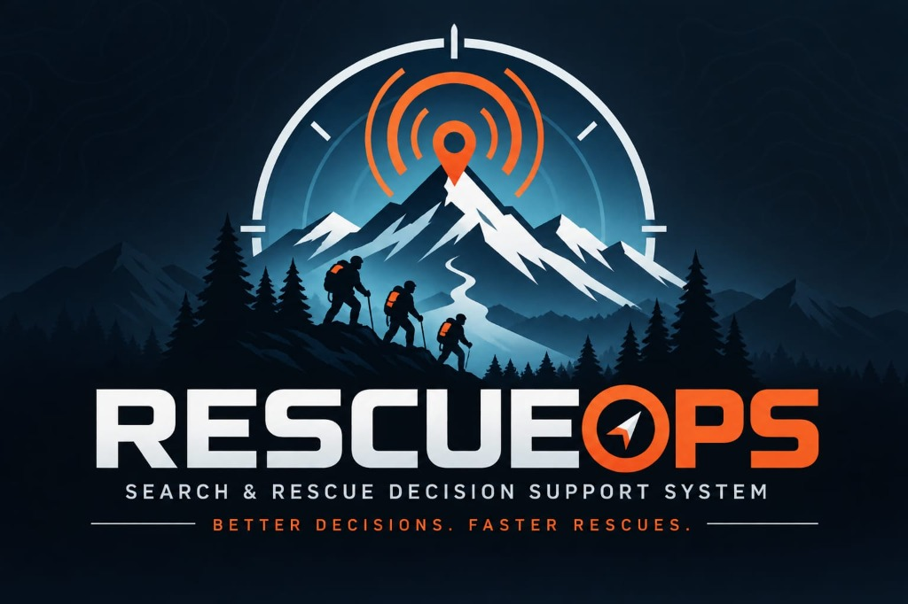

# RESCUE OPS — Smart Rescue Dashboard
## Operation: Lost Signal (Official Event Edition)

<p align="center">
  
</p>

A bright, clean, premium light-theme emergency decision-support web dashboard built for a mountain search-and-rescue coordinator during a worsening alpine storm.

Built with **plain HTML, CSS, and vanilla JavaScript** with no frameworks, backend, paid APIs, or external AI APIs.

---

## 1. Problem Overview
Six trekkers are missing across rugged mountainous terrain following a sudden severe mountain storm. Field conditions include:
- Depleting radio/phone batteries and weak or non-existent signals in steep ridges and gorges.
- Incomplete, delayed, or missing location pings.
- Multiple sectors requiring attention, with limited rapid-intervention search teams.
- Inclement weather (storm, gale winds, fog, rain) that slows search units and increases hypothermia risks.

The rescue coordinator needs a transparent dashboard to:
1. Prioritize missing individuals based on survival heuristics without presuming missing telemetry implies safety.
2. Direct attention to the highest-risk sectors.
3. Deploy and manage three field rescue teams (Team Alpha, Team Bravo, Team Charlie), track simulated transit, advance simulation time, and record timestamped incident actions.

---

## 2. Official Trekker Profiles (Preserved & Accurate)

Per event instructions, the official data from **Operation: Lost Signal** is preserved without invented GPS coordinates, synthetic medical conditions, or assumed battery levels. Unreported fields are explicitly identified:

| ID | Name | Sector | Last Ping | Elev. | Signal | Battery | Age | Gear & Situation |
| :--- | :--- | :--- | :--- | :--- | :--- | :--- | :--- | :--- |
| **TRK-01** | **Aarav Sharma** | Sector B-North (Ridge Trail) | 07:15 AM | ~2,450 m | Weak (1 bar) | 14% | 28 | Thermal tent, whistle, offline GPS. Minor ankle injury reported by radio; companion with him. |
| **TRK-02** | **Maya Patel** | Sector B-North (Ridge Trail) | 07:18 AM | *Not reported* | *Not reported* | *Unknown* | *Not reported* | Traveling tandem with Aarav Sharma along Ridge Trail. |
| **TRK-03** | **Rohan Varma** | Sector C-East (Gorge Creek) | 06:40 AM | *Not reported* | *Not reported* | *Unknown* | *Not reported* | Last ping registered near lower gorge drainage; deep canyon echo. |
| **TRK-04** | **Ananya Sen** | Sector A-South (Pine Basin) | 08:05 AM | *Not reported* | *Not reported* | *Unknown* | *Not reported* | Transmitted short telemetry heartbeat from south basin woods. |
| **TRK-05** | **Vikram Malhotra** | Sector D-West (Old Mine Pass) | 05:55 AM | *Not reported* | *Not reported* | *Unknown* | *Not reported* | Old mine pass terrain; high rockfall and scree hazard. Telemetry dormant (>3 hrs). |
| **TRK-06** | **Dr. Priyamvada Iyer** | Sector A-South (Pine Basin) | 08:12 AM | *Not reported* | *Not reported* | *Unknown* | *Not reported* | Recent ping near ranger station access trail in Pine Basin. |

---

## 3. Heuristic Priority Scoring & Telemetry Policy

The algorithm evaluates risk transparently on a scale of **0 to 100+ points**:
- **HIGH Priority (&ge; 70 pts):** Immediate emergency team dispatch advised.
- **MEDIUM Priority (40–69 pts):** Elevated vulnerability, stale telemetry, or data uncertainty.
- **LOW Priority (< 40 pts):** Monitored telemetry or safely located/sheltered.

### Evaluation Criteria:
1. **Reported Injury:**
   - Critical trauma: `+45 pts`
   - Minor / Mobility Impairment (Aarav's ankle injury): `+20 pts`
2. **Battery Level:**
   - $\le 10\%$: `+25 pts`
   - $11\% - 25\%$ (Aarav at 14%): `+15 pts`
   - $26\% - 50\%$: `+5 pts`
3. **Signal Quality:**
   - Dead Zone / Lost: `+20 pts`
   - Weak / 1 bar (Aarav): `+10 pts`
4. **Stale Telemetry (Time Elapsed since Last Ping):**
   - $> 180$ mins ago (Vikram Malhotra: 05:55 AM): `+30 pts`
   - $120 - 180$ mins ago (Rohan Varma: 06:40 AM): `+20 pts`
   - $60 - 120$ mins ago (Aarav, Maya): `+10 pts`
   - $< 60$ mins ago (Ananya, Priyamvada): `+0 pts`
5. **Data Uncertainty Penalty (Precautionary Safety Principle):**
   - Profiles with unconfirmed battery, signal, or medical status receive an automatic `+15 pts` uncertainty weight. **Crucial Rule:** *Lack of data is NEVER treated as proof of safety.*
6. **Weather Severity Factor:**
   - Severe Mountain Storm: `+15 pts` (Ground travel speed reduced 40%)
   - Dense Freezing Fog: `+10 pts` (Speed reduced 25%)
   - Cold Rain: `+5 pts` (Speed reduced 15%)
   - Clear Skies: `+0 pts` (Optimal speed)

---

## 4. Rescue Team Deployment Engine

The dashboard features three field rescue units:
- **Team Alpha:** Alpine Search & Dog Unit (Foot speed: 4.0 km/h)
- **Team Bravo:** Paramedic & Mountain Extraction (Foot speed: 4.5 km/h)
- **Team Charlie:** ATV & Drone Recon Unit (Speed: 12.0 km/h)

### Deployment Features:
- **Single-Assignment Enforcement:** A team can only be assigned to one trekker at a time. The system strictly prevents duplicate team assignments.
- **En Route & On Scene Status:** Coordinators can mark a team as `En Route` (recording the departure timestamp) and `On Scene`.
- **Simulated Transit & ETA:** Shows remaining simulated distance (`km`) and dynamic ETA calculated from unit speed and active weather multipliers.
- **Advance Time (`+5 Min Travel`):** Increments the simulated mission clock by 5 minutes, ages trekker stale pings, advances traveling rescue teams along their route, and triggers simulated arrival upon reaching destination.
- **Trekker Lifecycle & Safety Confirmations:** Supports `Missing` &rarr; `Search in Progress` &rarr; `Located` &rarr; `Rescued`. Status updates to `Located` or `Rescued` require explicit user modal confirmation to prevent accidental updates.
- **Incident Command Audit Trail:** Every dispatch, time advance, weather change, and status verification is logged with a simulation clock timestamp.

---

## 5. Setup & Local Demonstration

### Quick Start:
1. Open the project folder `e:\build in the box`.
2. Double-click [index.html](file:///e:/build%20in%20the%20box/index.html) in your browser.
3. *Or run a local server:*
   ```bash
   python -m http.server 5500
   ```
   Navigate to [http://localhost:5500](http://localhost:5500).

---

## 6. How to Demonstrate in 3 Minutes

1. **Review Official Registry:** Show the 6 official profiles. Point out that Aarav has verified telemetry while unknown fields for Maya, Rohan, Vikram, Ananya, and Priyamvada are explicitly marked as "Not reported".
2. **Explain Priority Rationale:** Click into **Aarav Sharma (TRK-01)** and **Vikram Malhotra (TRK-05)** to show the transparent point breakdown (Aarav has ankle injury + low battery; Vikram has >3hr stale ping penalty).
3. **Simulate Weather Impact:** Change weather from *Severe Mountain Storm* to *Clear Skies*. Note that scores decrease and simulated ETAs speed up.
4. **Deploy a Rescue Unit:**
   - On **Aarav Sharma**, select **Team Alpha** from the dropdown and click **Assign**.
   - Note that Team Alpha's status changes in the team bar and cannot be assigned to another trekker.
   - Click **🚀 Mark En Route** on Team Alpha. A departure log is recorded.
5. **Advance Time:** Click **⏩ +5 Min Travel** several times. Watch the simulated clock advance from `09:00 AM` &rarr; `09:05 AM` &rarr; `09:10 AM`, the distance count down, and the event log update.
6. **Verify Status with Confirmation:** Click **📍 Verify Located** or **🚁 Verify Rescued**. The confirmation modal will prompt the coordinator to confirm before releasing the team and locking safety.
7. **Reset Scenario:** Click **🔄 Reset Scenario** to restore initial mission state.

---

## 7. Assumptions & Disclaimer
- **Simulated Data & Decision Support:** All distances, transit speeds, and ETA predictions are **SIMULATED** and intended solely for decision support during the hackathon challenge. No real GPS coordinates or real-world routing predictions are implied.
- **Browser-Only Execution:** All state is handled in-memory via vanilla JavaScript with zero tracking or external telemetry.
